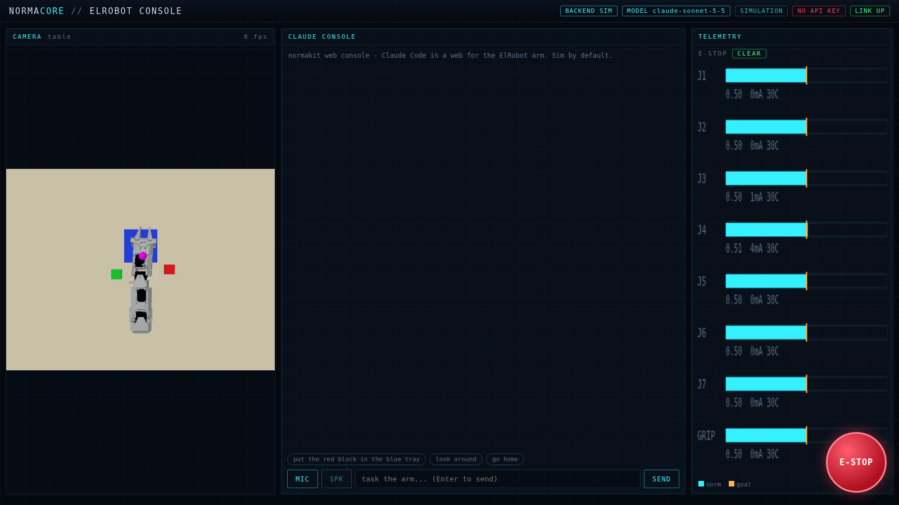
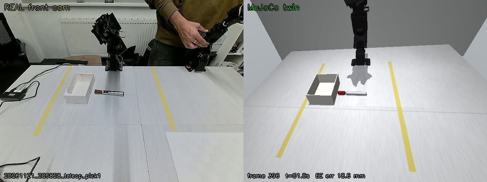
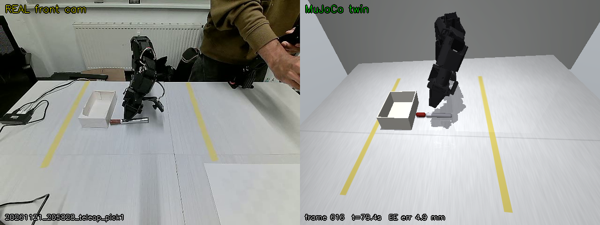
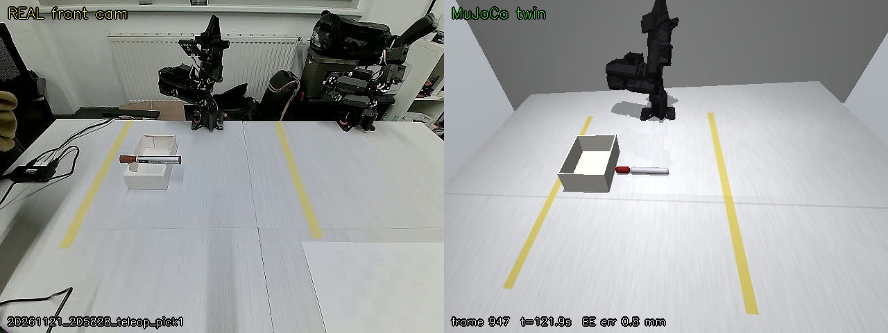

# 14 - Digital twin video replay

The ask: "I need to see the output, how it looks. Can we do the digital twin kind of thing - can you
create a screen based on the videos we have? Maybe in MuJoCo or others?"

Answer, in two parts:

1. **A screen to drive the arm**: the web console (`webapp/`, docs/13) running on the sim backend,
   screenshotted headless below.
2. **A digital twin of a real video**: the recorded teleop pick session replayed joint-for-joint
   through the MuJoCo servo twin and rendered next to the real camera footage, side by side.

## 1. Web console screenshot

`docs/twin/webapp_console.png` - headless Chrome shot of the live console on the pybullet sim
backend (`--backend sim`, port 8920): dark HUD, camera panel streaming the sim table over
WebSocket, Claude console with chat input, J1..J7 + GRIP telemetry bars, E-STOP. No hardware and
no API key needed to look at it (chat replies need `ANTHROPIC_API_KEY`).



Regenerate (one command, starts the server, waits for the stream, screenshots, cleans up):

```bash
bash scripts/screenshot_webapp.sh
```

(`BUDGET`/`EXTRA_WAIT`/`OUT` env vars if the first paint comes out blank; Chrome dbus warnings are
harmless.)

## 2. Digital twin of the teleop video

**Source footage**: `run/recordings/20261121_205828_teleop_pick1/` - `front.mp4` (calibrated front
camera, 640x480 at 8 fps, 1058 frames) plus `joints.jsonl` (one line per video frame with the raw
servo ticks of all 8 joints; line `i` is video frame `i`). This is the same footage as
`presentation/videos/teleop_pick1.mp4`: a human teleoperates the follower arm, picks up a white
board marker and drops it into a cardboard tray.

**Twin scene**: `assets/mujoco/twin_desk_scene.xml` - the calibrated `elrobot_scene.xml` arm/table
twin plus the two objects seen in frame 0: the white cardboard tray (`white_tray`) and the marker
(`marker`). Their poses were measured on real frame 0 by projecting clicked pixels through
`calibration/table_mujoco_front.json` (homography, pixel on the table plane -> robot xy metres)
and iterated against the twin render to ~10 px: tray `(0.136, 0.258) m, yaw 0`; marker
`(0.023, 0.265) m, yaw 3.12 rad`.

**Replay method** (`scripts/twin_replay.py`, pattern from `scripts/validate_twin.py`): not a
kinematic puppet - the recorded raw servo ticks are written into the twin's simulated ST3215
registers (`REG_GOAL_POS` via `MujocoBackend._sync`) and MuJoCo physics steps the real elapsed
`dt` per frame, so PID, quantisation, deadband, backlash, bus lag and contacts all act exactly as
in the validated twin. EE position error is tracked each frame against `normakit.kin.Kin` FK of
the commanded joints.

### What it looks like

Real front camera (left) vs MuJoCo twin (right), same frame, same instants:





All 8 stills: `docs/twin/twin_vs_real_f0{286,396,506,616,727,837,947}.png` + `f1057.png`.
Video: `docs/twin/twin_replay_sidebyside.mp4` (60 s, 13.7 MB, the most active block, frames
322-801). GIF preview: `docs/twin/twin_replay_preview.gif` (7.2 MB).
Frame-0 camera alignment overlay: `docs/twin/camera_align_f0.png`.
All numbers: `docs/twin/replay_metrics.json`.

### Measured numbers (from `docs/twin/replay_metrics.json`)

| Metric | Value |
|---|---|
| Frames replayed (full clip) | 1058 (action window 286-1057) |
| EE replay error, mean / RMS / p95 | **4.93 mm / 15.25 mm / 15.58 mm** |
| Front camera intrinsics reprojection residual (`calibration/camera_front.json`) | **0.39 px** |
| Frame-0 tape-line alignment (twin - real, x-px at mid-height) | **+14.6 px / -43.2 px** |
| Marker max height in sim / real outcome | **0.72 cm (never lifted)** / grasped and placed in tray (~frames 600-760) |

Reading of the tape-line row: the twin's `table_tex.png` yellow tapes sit at robot `x=-0.15/+0.21 m`
(shared with `elrobot_scene.xml`), while this session's real table tapes measured `x=-0.21/+0.24 m`
via the homography. So most of the tape diff is a real-table vs texture mismatch, **not** camera
error; tray, marker and tape all land within ~15 px of the real pixels (see `camera_align_f0.png`).

### Honest limits

- **The sim marker is never grasped.** At the recorded grasp (jaw closes ~frame 640) the recorded
  joints put the jaw tips ~5 mm from the marker in xy but ~40 mm above the table, while straddling
  a 15 mm marker needs the tips at ~10-15 mm. In the real video the same recorded joints do grasp
  it. This is a twin-vs-real modelling residual (guess: wrist-pitch / calibration residual,
  ISSUE-116), not a replay bug: the arm servo replay itself (the deliverable) tracks within the
  numbers above.
- The leader arm and the human hands visible in the real footage are not modelled; the twin shows
  the follower only.
- Background clutter (room, radiator, cables, second arm base) is absent; the twin renders table,
  tray, marker, arm.
- The twin camera is ideal pinhole with the calibrated `(fx, fy, cx, cy)`; the real lens's radial
  distortion (~1-4 px near corners) is not rendered.
- The cardboard tray is modelled as a rigid box; the real tray flexes and its tape seams are not
  textured.
- Servo replay tracks the joints within the reported mm, but small joint errors integrate into
  object-contact outcomes, so objects can diverge even when the arm matches (the marker case).
- `joints.jsonl` line `i` aligns with video frame `i` (verified visually); its `t` column drifts
  +3.8 s over the clip (dt mean 0.1286 s vs video 0.125 s), so sync uses the frame index, never
  `t` (ISSUE-118).

### Regenerate everything (one command)

```bash
.venv/bin/python scripts/twin_replay.py --session run/recordings/20261121_205828_teleop_pick1 --out docs/twin
```

Replays all 1058 frames, rewrites the stills, mp4, gif, `camera_align_f0.png` and
`replay_metrics.json`. Object poses default to the measured values and can be nudged with
`--tray-x/--tray-y/--tray-yaw/--marker-x/--marker-y/--marker-yaw`.
